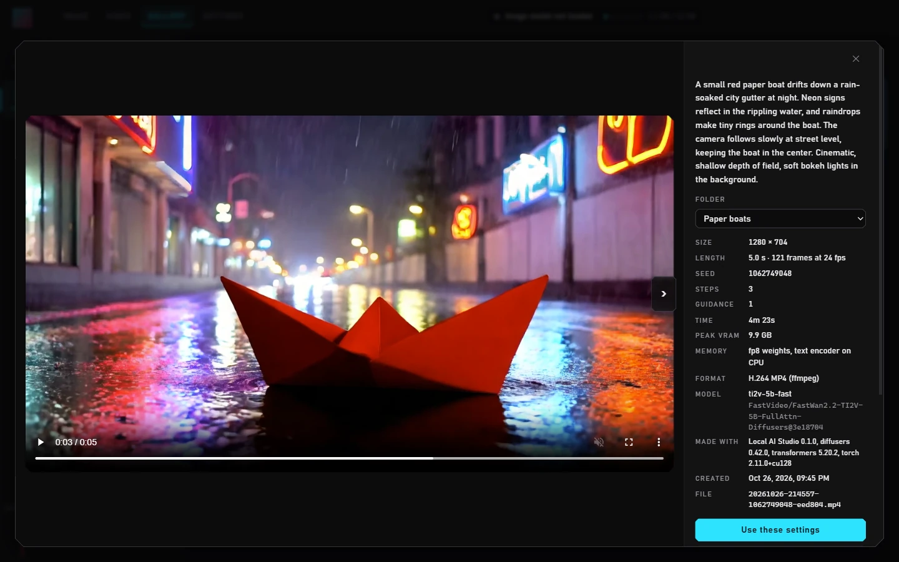
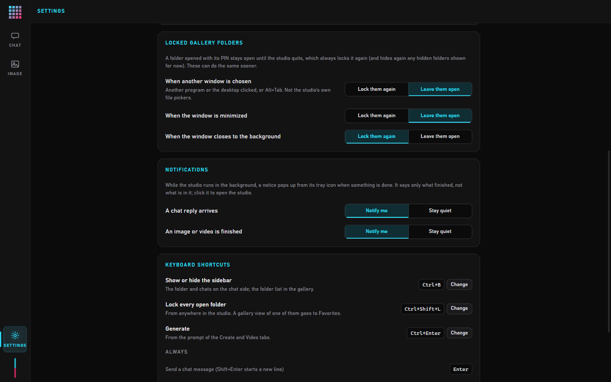
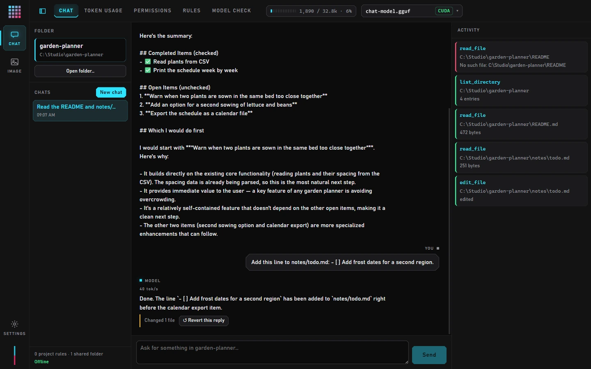
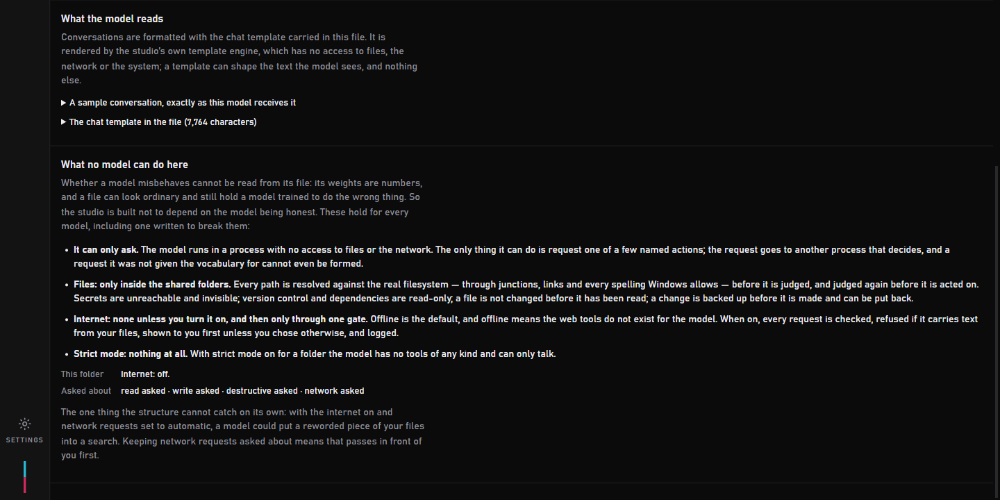
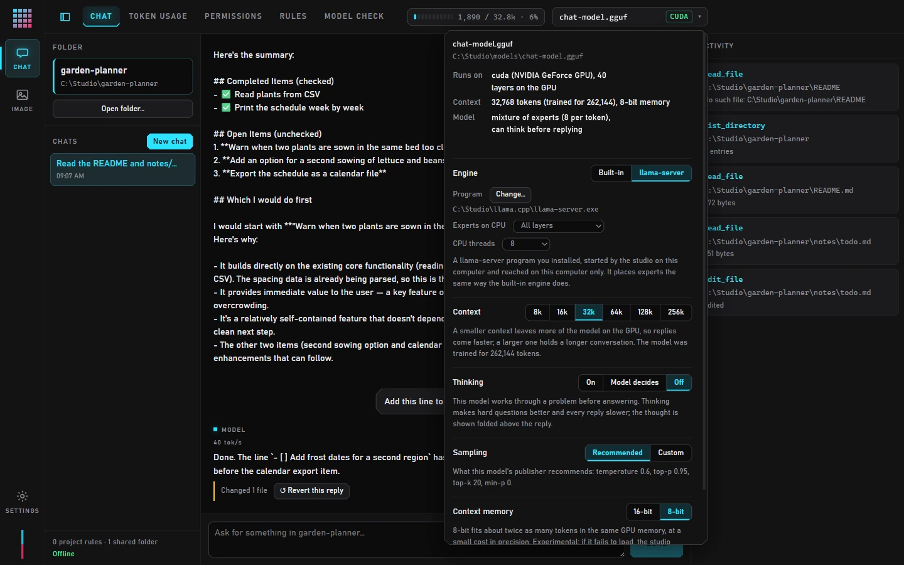
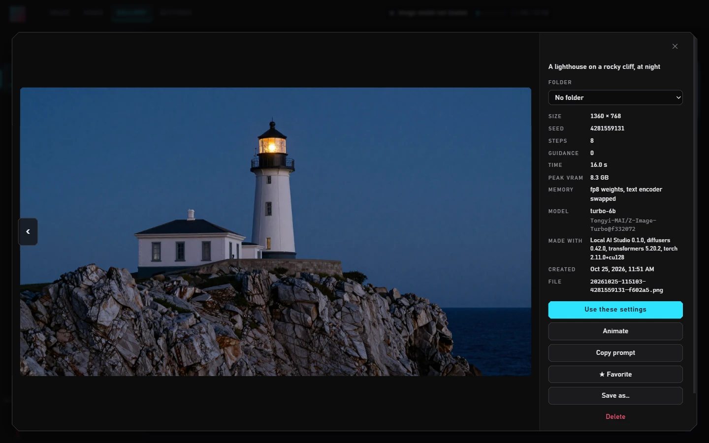
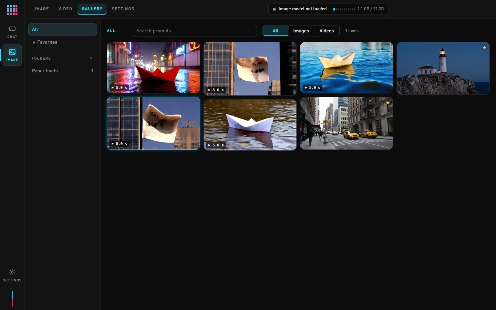
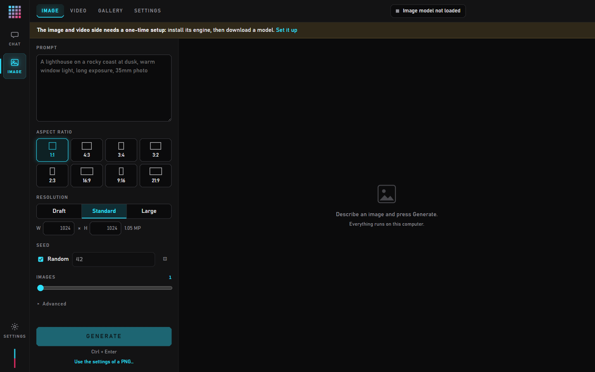
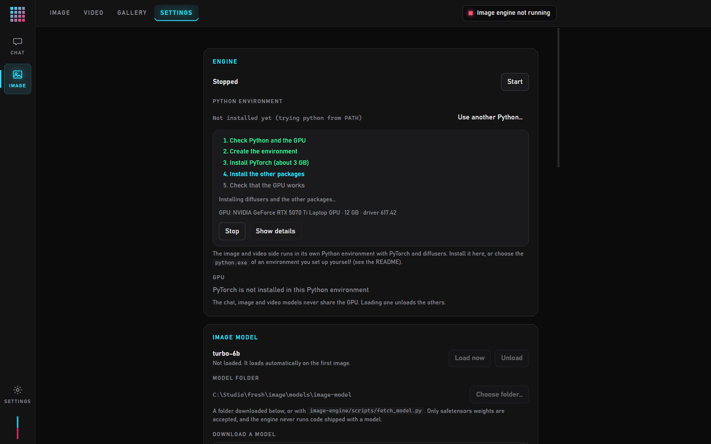
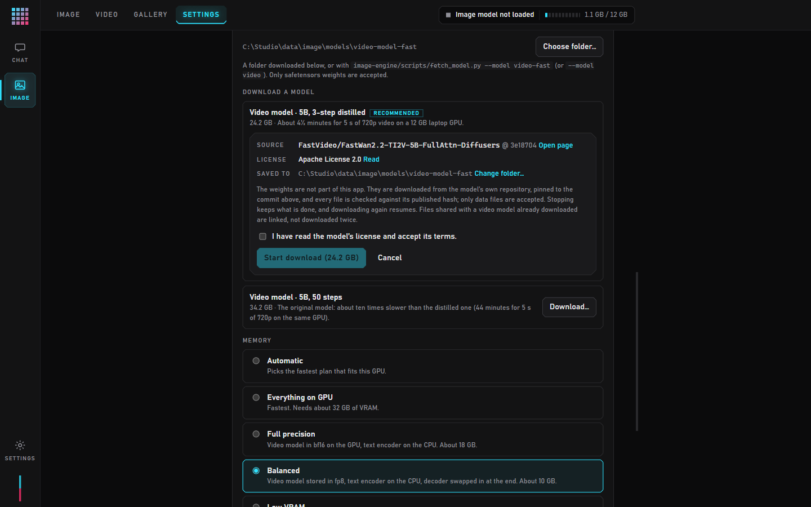

# Local AI Studio

A local-first desktop studio for running AI models on your own computer: an agent that
works inside your project folders using GGUF language models (llama.cpp, built in or as
llama-server), and an image and video generator. Made to run well on a 12 GB GPU.
No cloud model, no account, no telemetry.

- **Agent per folder.** Open a folder and it becomes a workspace: the agent's working
  folder, with its own chats (kept across restarts), project rules on top of your global
  rules, and its own permissions.
- **Built for models that make mistakes.** Small local models misread instructions and get
  things wrong, so safety is not left to the prompt. Protected paths the agent cannot
  reach or change, no edits to files it has not read, a brake on runaway deletes, and a
  change history that can put back any reply's changes. All enforced by the one component
  that touches the disk, whatever the model says.
- **Big models on a small GPU.** A mixture-of-experts model bigger than the GPU runs with
  only its experts in system memory and everything else on the GPU: 34 tokens/s for a 35B
  model with 3B active on a consumer GPU, through llama-server. Sampling follows what
  the model's publisher recommends for its family, read from the file's header, and each
  reply shows how long the model thought and how fast it wrote.
- **Know what you load.** *Model check* reads a GGUF file with the studio's own strict
  parser before llama.cpp is allowed near it, shows the chat template the model will
  actually read, and points out instructions in it worth a look. *Strict mode* makes a
  workspace conversation only, with no tools at all.
- **Chats stay yours.** Conversations are encrypted on disk with a key Windows keeps for
  your user account.
- **Close means quit, or keep working in the background.** By default closing the window
  stops everything and frees the GPU. In Settings it can instead hide to the tray, with
  long work carrying on and each model (chat, image, video) kept on the GPU or unloaded
  once idle, as you choose. A notice from the tray says when a chat reply, an image or a
  video is done (each can be turned off).
- **Offline unless you say otherwise.** The agent has no internet access by default. Web
  search, or search plus downloads, can be switched on per workspace; every request is
  shown before it is sent and written to a log, and text from your files is never put in
  a request.
- **Images** from a 6-billion-parameter few-step diffusion model, run locally through
  diffusers, with live progress and a searchable gallery.
- **Videos** of up to 5 seconds at 720p from a 5-billion-parameter text-and-image-to-video
  model: from a prompt alone, from any picture, or continuing a clip from its last frame.



*A 5-second 720p clip from the 3-step video model, made in about 4½ minutes on a consumer
GPU. Every image and video in the gallery keeps its prompt, settings and the
model revision it came from. All pictures in this README are real output of the
studio.*

## Why this exists

Local-model tools today each cover part of the job:

|                                   | Runs local LLMs | Changes files | Agent per folder | Enforced safety | Local images |
| --------------------------------- | :-------------: | :-----------: | :--------------: | :-------------: | :----------: |
| Local chat apps and model runners |       ✅        |      —        |        —         |        —        |      —       |
| Node-based image tools            |       —         |      —        |        —         |        —        |      ✅      |
| Cloud-based coding agents         |       —         |      ✅       |        ✅        |     varies      |      —       |
| **Local AI Studio**               |       ✅        |      ✅       |        ✅        |       ✅        |      ✅      |

## How it works

```
┌─ Window (React) ────────────────────────┐  The view. No filesystem access, no network.
│  Chat · Usage · Permissions · Rules     │  Reaches the main process through named
│  Image · Video · Gallery · Settings     │  operations only, never a generic channel.
└──────────────────┬──────────────────────┘
                   │ IPC
┌──────────────────▼──────────────────────┐
│  Main process                           │  ★ The only code that touches your files.
│  permission broker · GPU arbiter        │  Decides which model may hold the GPU.
│  image bridge · studio-image: protocol  │
└───────┬───────────────────────┬─────────┘
        │ messages              │ HTTP on 127.0.0.1, per-launch token
┌───────▼─────────────┐ ┌───────▼─────────────────────┐
│ Chat engine         │ │ Image engine (Python)       │
│ node-llama-cpp, or  │ │ PyTorch + diffusers +       │
│ llama-server on     │ │ image and video models      │
│ 127.0.0.1 + GGUF    │ │                             │
│ No file authority.  │ │ Gallery on disk, no files   │
│                     │ │ outside its own data folder │
└─────────────────────┘ └─────────────────────────────┘
```

**Each engine runs in its own process.** llama.cpp and PyTorch are native code; a
malformed model or an out-of-memory error can end the process. Isolating them means
that costs you the model, not the application. The component that handles raw model
output holds no authority of its own: the chat model can *ask* for a file to be read,
and has no idea how to read one.

**The window never talks to the image engine.** Every image request goes through the
main process, which forwards it over loopback with a token generated fresh at every
launch and passed through the environment. Generated images reach the window through a
private `studio-image:` protocol. The engine refuses any request without the token,
anything that looks like it came from a browser, and any Host header that is not this
machine. If the studio is killed, the engine notices its parent is gone and exits.

**The window only ever shows the studio.** Navigation away from it is refused, so a file
dropped on the window or a followed link cannot load some other page with the studio's
bridge to the main process attached.

**One model on the GPU at a time.** A 9B chat model and the image model do not fit on a
12 GB card together. Loading one unloads the other first, with a short notice. If the
other side is busy (a reply streaming, an image generating), the switch is refused with
a reason instead of interrupting it.

**Closing the window** quits by default, which frees the GPU. Settings can keep the
studio running in the tray instead, choosing per model whether it stays loaded, whether
a notice pops up when a reply, an image or a video is done, and when open gallery
folders lock again; the keyboard shortcuts are there too.



## Chat



*A 35B model with 3B active through llama-server on a consumer GPU, in a demo
folder. The first read failed (the model asked for `README` without its extension) and
it tried again; the reply shows its speed, and the change it made can be put back with
one click.*

**Tool calls are constrained at the token level.** The JSON schema for each tool is
compiled into a GBNF grammar, so the model is structurally incapable of emitting a call
with a missing or misspelled argument. Reliable multi-step tool use is the thing small
models are worst at, and it is cheaper to make the malformed call impossible than to
parse and retry it.

### Workspaces

**Opening a folder makes it a workspace.** The folder becomes the agent's working folder:
it is shared without being asked for, relative paths resolve against it, and the system
prompt tells the model where it is. Each workspace keeps its own

- **chats**, listed in the sidebar and continued where they left off, after switching
  or restarting (the model's own chat history is saved and restored, not just the text).
  The sidebar can be hidden (**Ctrl+B**); the folder, chat and internet level then stay
  in a line above the conversation;
- **project rules**, followed after the global rules, only in that folder;
- **extra shared folders**, "always allow" grants, session grants and undo history.

Everything is stored in the application's data folder. Opening a folder writes nothing
into it. One workspace is open at a time; switching is refused while a reply is running,
because a reply belongs to the folder and chat it started in.

### The permission model

**Shared folders are the boundary.** The agent can only reach paths inside the working
folder and any other folders you have shared in that workspace. A path outside them is refused before any rule is read, and no
rule, setting or click can widen that. Paths are resolved against the real filesystem
first, so a junction pointing out of a shared folder is followed to where it really goes
and then refused. On Windows that matters, because all of these name the same file:

```
C:\work\..\work\notes.txt      lexical detour
C:\work\link\notes.txt         a junction pointing anywhere at all
C:\PROGRA~1\notes.txt          8.3 short name
\\?\C:\work\notes.txt          extended-length prefix
C:work\notes.txt               drive-relative, depends on a per-drive cwd
C:\work\notes.txt.             trailing dot, silently stripped by the OS
C:\work\notes.txt:hidden       alternate data stream
```

**Protected paths cannot be reached, whatever the model does.** Inside the shared folders,
some paths are *no access* (cannot be read, changed, or even seen in a listing) and some
are *read-only*. Every workspace starts protected: secrets (`.env`, `*.pem`, `*.key`,
SSH and cloud credentials, password databases) are no access, and version control and
installed dependencies (`.git`, `node_modules`, `.venv`) are read-only. Add your own in
the Permissions tab (`data/raw`, `*.sqlite`). These are enforced by the broker on every
call, before any rule, mode or approval; the rules on the Rules tab are advice to the
model, these are not.

**No reading through hard links.** Resolving a path follows junctions and symbolic links,
but a hard link is a second name for the same contents, and the other name can be
anywhere on the drive. A file with more than one name is not read. (Writes and deletes
need no such guard: a write is a temp file renamed over the name, so the other name keeps
the old contents, and a delete moves the name to the recycle bin.)

**No blind changes.** An existing file can only be replaced or edited after the agent has
read it in this conversation, and only while it is unchanged since. A model that guesses
at a file's contents, or edits a file you changed after it looked, is refused and told to
read it again.

**A brake on runaway changes.** However the modes are set, a reply that has already
deleted three files, or changed twenty, has to ask before each further one.

**Risk classes decide what gets asked about.** Reading, writing and deleting each switch
between *ask every time* and *run automatically*. A master *confirm everything* switch
overrides all of it.

**Rules are the exceptions you accumulate.** Choosing "always allow" in a prompt writes a
rule for that workspace, and the prompt shows the sentence of the rule it is about to
write. Denials always beat allowances.

Every approval prompt shows the **resolved** path and a preview of the change. The path
is resolved again immediately before the action runs, and the action is refused if it no
longer names the same file. Writes are atomic. Deletes go to the recycle bin.

**Every change can be put back.** Before the agent changes a file its old contents are
backed up, and the change is recorded under the message that led to it. A reply that
changed files shows *Revert this reply* under it, and the Permissions tab lists the whole
history. The history is kept on disk, so it still works after a restart. A file that was
edited again since (by you or by a later reply) is reported before anything is
overwritten, and a revert is itself recorded, so it can be undone.

### Internet

Each workspace has an internet level, **Offline** by default:

| Level               | What the agent can do                                                   |
| ------------------- | ----------------------------------------------------------------------- |
| Offline             | Nothing on the internet. The web tools are not even offered to the model. |
| Search only         | Search the web and read public pages. Nothing is saved.                 |
| Search and download | The above, plus saving files from the web into the folder as new files. |

Choosing anything but Offline asks for confirmation first. The model never makes a request
itself: it asks, and the app checks the request, shows it to you (exactly what is sent, and
to whom) and only then sends it. Requests are GET only, with no body.

- **Your files stay in.** A search query or address that repeats six words in a row, or any
  long identifier, from a file the agent has read in this conversation is refused before
  you are even asked. Reworded fragments can still pass this check, which is why every
  request is shown to you first unless you choose otherwise.
- **The local network stays out.** Addresses on this computer or the local network are
  refused, including public names that resolve to them and redirects that lead to them.
- **Downloads are contained.** New files only, never over an existing one, never into a
  protected path, never a program or script, at most 50 MB, and recorded in the change
  history so they can be reverted.
- **Everything is logged.** Every request the agent asked for, including refused and
  declined ones, goes into the workspace's internet log: time, query or address, outcome,
  size, and the chat it came from.

The window itself is cut off from the internet at every level: any request it makes to an
outside address is cancelled. Web search goes to a single search API with your own key,
stored encrypted by the operating system; its address is shown next to the key and in
every approval. The chat engine only runs its prebuilt binaries
and never builds or downloads anything.

### Strict mode

A folder can be put in **strict mode** (Permissions tab): conversation only. The model is
given no tools of any kind — no reading, listing or changing files, no internet, whatever
the other settings say. It is not told any tool exists, the grammar that shapes its output
has no function calls in it to make, and a call that arrives anyway is refused before any
broker sees it. For talking with a model you do not yet trust, or when nothing should be
touched. The badge in the sidebar and the chat header says when it is on.

### Model check

The **Model check** tab answers what can be answered about a model file, and says what
cannot.

- **The file.** A GGUF file is read by the studio's own strict reader, independent of
  the inference library: every count, length and offset in the header is checked against
  the file, tensors must be of known types, fit, align and not overlap, and anything the
  loader would not understand is a reason to refuse rather than guess. The same check
  runs at load, so a file that fails it is never handed to the native loader. The report
  adds what the metadata says (architecture, weights, context, vocabulary, publisher,
  license, source), reads the chat template for text the model would see and you would
  not (invisible characters, "do not tell the user", web addresses, the studio's own tool
  names, code-like escapes), lists every metadata key, and hashes the file to compare
  with the publisher's SHA-256. Other formats go through the Python inspector described
  under Images.
- **What the model reads.** Whether the file's own chat template is run or a built-in
  one for the family, and a sample conversation rendered exactly as the model receives
  it. Templates are rendered by a template engine with no access to files, the network or
  the system.
- **What no model can do here.** Whether a model misbehaves cannot be read from its
  weights, so the tab ends with what holds for every model — it can only ask; files only
  inside the shared folders; internet only through the gate; nothing at all in strict mode
  — together with this folder's current settings, and the one residual the structure
  cannot catch (a reworded leak through an automatic search).



### Rules and token usage

Standing instructions are prepended to every conversation: global rules everywhere, then
the open workspace's project rules. Each is switchable on its own and shown with its
token cost, and a saved change applies from the next message without clearing the chat.
On a local model the system prompt comes straight out of the room the model has to think
in, so the cost is worth seeing.

The **Token usage** tab shows what fills the context window, measured with the loaded
model's own tokenizer and chat template rather than estimated: instructions and rules,
each tool's description, messages, replies, tool results, per turn, with plain-language
findings such as "Most of it is tool results (62%)" and "Room for about 2 more turns like
the last few".

**The model menu** (click the model's name) shows what the file's header says about the
model — architecture, whether it is a mixture of experts, its weight format, whether it
can think before replying — and holds the settings that follow from it. Nothing here is
tied to one model: the header decides the defaults, and each can be changed.



- **Context.** How much of the conversation the model can see at once. The default is
  32k tokens, or the size the model was trained for if that is smaller: a model trained
  for 262k would otherwise claim memory for all of it and push its weights off the GPU. Smaller is
  faster, larger holds a longer conversation; a change takes effect at the next load.
- **Thinking.** For a model whose chat template has a thinking segment: on, only when
  the model starts one itself, or off (the default, for the quickest answers), with a cap
  on how long a thought may run. The
  thought streams into a folded block above the reply, open while the model is still
  thinking so the wait is visibly work.
- **Sampling.** The temperature and top-p / top-k / min-p the model's publisher
  recommends for its family, applied automatically, or numbers of your own. Without
  these the inference library samples greedily, and a thinking model run that way tends
  to repeat itself.
- **Context memory.** The context can be stored in 8-bit instead of 16-bit, which fits
  about twice as many tokens in the same GPU memory at a small cost in precision. 8-bit
  is the default; the underlying option is experimental in the inference library, so an
  8-bit load that fails is retried at 16-bit automatically.

## Image



- **Prompt to image** with aspect-ratio presets, Draft / Standard / Large resolutions,
  batches of up to 8 images, and fixed or random seeds.
- **Live progress** for every sampling step, and a queue you can keep adding to. The
  progress card's *Cancel this one* stops the job it shows, between steps; everything
  else waiting is in the **queue window**, which opens after Generate (that can be
  switched off) or from the card's *Queue* button. There each job waiting can be edited
  — prompt, aspect ratio and resolution, count, steps, guidance, negative prompt, seed —
  or removed, and keeps its place in line. The one being made can be cancelled, or
  edited too: saving stops it and starts it again with the changes, first in line, and
  whatever it already finished stays in the gallery.
- **Gallery**: search by prompt, full-size view with keyboard navigation, one click to
  reuse an image's exact settings, "Save as…" to put a copy anywhere. Thumbnails come
  in three sizes — Large, Medium and Small, as a file manager's views — and the choice
  is remembered.
- **A mosaic over the thumbnails**, weak or strong, for a screen other people can see.
  Each thumbnail is drawn a few blocks wide and blown back up, so the grid says nothing
  at a glance. It covers the grid only: opening an item shows it as it is, its prompt is
  still its tooltip and still searchable, and no file is changed. To keep things out of
  view altogether, use a hidden or locked folder.
- **Folders and favorites.** Make, rename and delete your own folders and drag images
  and videos onto them; deleting a folder never deletes what was in it. Drag the folders
  themselves to put them in the order you want (a deliberate pull, so clicking one never
  reorders the list; Alt with an arrow key does the same without a mouse), or leave them
  alphabetical. Favorites are their own view, showing every starred item wherever it is
  filed.
- **Several at once.** *Select* (or Ctrl+click, Shift+click for a run, Ctrl+A for every
  item shown) chooses several items to move to a folder, save, or delete together, and
  dragging a chosen tile takes all of them. *Save copies…* writes them into a folder you
  pick, never over a file already there, with two choices: keep the prompt and settings
  inside the images or not, and write each prompt and its settings to a `.txt` beside it.
- **Filing by keyboard.** **Ctrl+M** (changeable in Settings) opens the folder list
  numbered: 1 to 9 for the first nine folders in list order, 0 for no folder. It works
  in an item's details and on a gallery selection. In the details the left and right
  arrows always go to the previous and next item, even from the folder list.
- **Hidden and locked folders.** A folder can be hidden (it leaves the folder list, and
  what it holds leaves every view and search until *Settings → Show hidden folders*) or
  locked with a six-digit PIN. Both reset whenever the window closes: hidden folders hide
  again and unlocked ones lock. This keeps the studio's own views private; it does not
  encrypt the files on disk.
- **Reproducible files, private exports.** Each image in the gallery carries its full
  generation settings and where it came from (app version, the model's exact revision,
  library versions). Drop such a PNG on the image side, or choose one with *Use the
  settings of a PNG…*, and the form takes its settings with the seed locked. Copies made
  with "Save as…" leave the prompt and settings out by default, so a shared image does
  not carry its prompt along; one setting under **Settings** keeps them in.
- **Checked downloads.** Model files are pinned to a commit, hash-verified and inspected
  before they are ever loaded; only safetensors weights are accepted. See
  [docs/image-engine-security.md](docs/image-engine-security.md).
- **Inspect any model file yourself.** *Settings → Inspect a model file* shows a
  downloaded file's SHA-256 (paste the publisher's to compare) and what
  `image-engine/scripts/inspect_model.py` finds in its header and metadata: pickle
  checkpoints, a malformed header, code-like text, embedded files or encoded blobs, text
  hidden in byte tensors, and whether it matches a model structure the studio knows.
  It reads the file without loading or running it, on this computer only; a malware scan
  is left to your antivirus.



### Memory modes

The image model's diffusion transformer is 12.3 GB in bf16 and its text encoder another 8 GB. The text
encoder only runs when the prompt changes, and its output is cached, so it can live in
system RAM and visit the GPU briefly.

| Mode | Image model | Text encoder | VRAM |
|---|---|---|---|
| Everything on GPU | bf16, resident | resident | ~24 GB |
| Full precision | bf16, resident | swapped in per prompt | ~16 GB |
| Balanced | fp8 storage, bf16 compute | swapped in per prompt | ~10 GB |
| Low VRAM | fp8 storage | every part moved in only while it runs | ~6 GB |

**Automatic** picks the fastest mode that fits the detected GPU.

### Models shared as a single file

Some models are shared as one `.safetensors` file holding only the transformer (often in
fp8, with a scale per tensor) rather than as a diffusers folder. *Settings → Image model →
Import a model file…* takes such a file for either image model, and *Settings → Video
model → Import a model file…* one of the video model:

- **the 6B model** (any fine-tune of it, distilled or base): the rest of its folder (text
  encoder, tokenizer, VAE, scheduler, the transformer's configuration) comes from the 6B
  download, or, if that is not there, from an 8.2 GB download of just those parts;
- **a 12B single-stream model** that reads its prompt through a 4B vision-language model
  (the same one the Train tab uses for captions) and needs a 254 MB VAE. It comes as a
  base model (28 steps, guidance 4.5) or a distilled one (8 steps, no guidance), takes no
  LoRAs and cannot be trained yet; the window says so and keeps the LoRA picker out of the way;
- **the 5B video model** (the architecture of the video downloads, as the original or a
  3-step distillation like the distilled download): the rest of its folder comes from the
  original video download, or from a 14.2 GB download of just those parts;
- **a 14B video model**, text to video or image to video: two files of the same size, one
  per "expert" (the first works on the noisy start of a clip, the second on the details).
  You choose both; files named "high noise" and "low noise" are put in order by
  themselves. It comes as the original (40 steps with guidance) or a few-step distillation,
  for which you enter the steps and shift its download page gives. The rest of its folder
  is an 11.9 GB download, of which only 0.5 GB is new when the 5B model is already there
  (they share the text encoder). The 14B models make 480p or 720p at 16 fps; the text
  model never takes a start picture and the image model always needs one.

A file of any other size of these model families is refused by its structure, before any
part is downloaded.

The file is never loaded as it is. The import reads its header and says which model it
is, then checks every tensor against that model's structure (names, shapes, dtypes, the
fp8 scales and the small quantization tags stored next to them), hashes it and compares
it with the hash from its download page if you paste one, downloads any missing part
after showing its source and license, and links everything into a new model folder (hard
links where the disk allows, so no second copy), which it selects. You say whether the
file is a distilled or a base model; for the image models that sets the default steps and
guidance, for the video model it chooses between the original 50-step sampling and the
fixed 3-step schedule. The same steps from a terminal:

```
python image-engine/scripts/import_model.py --transformer <download>.safetensors --probe
python image-engine/scripts/import_model.py --transformer <download>.safetensors --variant distilled \
    --parts-from <models>/image-model --dest <models>/my-6b-model --sha256 <published SHA-256>
python image-engine/scripts/import_model.py --transformer <download>.safetensors --variant base \
    --text-encoder-from <models>/caption-model --vae-from <models>/large-vae --dest <models>/my-12b-model
python image-engine/scripts/import_model.py --transformer <download>.safetensors --variant distilled \
    --parts-from <models>/video-parts --dest <models>/my-video-model
python image-engine/scripts/import_model.py --transformer <high noise>.safetensors \
    --transformer-2 <low noise>.safetensors --variant distilled --steps 4 --shift 5 \
    --parts-from <models>/video-14b-text-parts --dest <models>/my-14b-model
```

A 6B file stored in fp8 stays in fp8 in every memory mode and takes LoRAs like the
download does (training them needs the distilled model); a bf16 one behaves exactly like
the download. For the 12B model, the linear weights stay in fp8 in every memory mode (a
bf16 file is quantized per output row as it loads) and are widened to bf16 just before
each matmul. A video file stored in fp8 likewise stays in fp8 in every video memory mode
(about 5 GB instead of 10 for the transformer); a bf16 or fp16 one behaves like the download.

A 14B expert is about 14 GB even in fp8 (a bf16 file is quantized as it loads), more than
a 12 GB card holds, so there it is streamed from RAM block by block (*Balanced*). Only one
expert runs at a time. When both fit in RAM with the text encoder (about 48 GB) both stay
loaded; otherwise the first is dropped when the second takes over, and each clip reads
both from disk once (about 28 GB: seconds from an internal SSD, longer from a USB drive).
*Low VRAM* always keeps just one. A 14B clip takes many minutes on a 12 GB card; a
few-step distillation is what makes it practical there.

The 12B model's memory modes:

| Mode | Transformer | Text encoder | VRAM |
|---|---|---|---|
| Everything on GPU | fp8, resident | resident | ~26 GB |
| Model on GPU | fp8, resident | on the CPU | ~17 GB |
| Balanced | fp8, streamed from RAM block by block | swapped in per prompt | ~11 GB |
| Low VRAM | fp8, streamed | on the CPU | ~4 GB |

Streamed, the transformer's 28 blocks wait in pinned RAM (about 13 GB, plus 8 GB for the
text encoder) and visit the GPU one at a time, the next one copied while the current one
computes, so a 12 GB card runs the model without holding it.

## Video

- **Two models, one engine.** The original model (50 steps with guidance) or its 3-step
  distillation, which makes a clip from far fewer transformer passes. The engine tells
  them apart by the model folder; with the distilled one, steps and guidance are set by
  the model and the Video tab says so. Both share the text encoder, VAE and tokenizer, so
  the second download is only its 10 GB transformer.
- **Text to video, or picture to video.** Describe a scene and how it moves, and
  optionally give the picture the video should open on: a file, a picture dropped on the
  Video tab, or **Animate** on any image in the gallery. A picture of another shape is
  cropped to the video's, never stretched.
- **Clips of 2 to 5 seconds** at 24 fps, in 16:9, 9:16 or 1:1, at 720p (what the model
  was trained at), 540p or 480p. Smaller sizes are several times faster.
- **Longer videos, one clip at a time.** **Continue from last frame** starts a new clip,
  at the same size, from where the last one ended. Joined clips drift a little in faces
  and colour over time, which is why it is a step you take rather than automatic.
- **The same queue, progress and gallery** as images, with time left shown for long
  jobs. Videos play in the gallery; the filter shows images, videos or both.
- **MP4 through ffmpeg, if you have it.** ffmpeg is not bundled. The engine finds it on
  PATH or where winget installs it, or you choose it in Settings. Without it, videos are
  saved as animated WebP, so a finished generation is never lost.
- **Nothing inside the file.** A video carries neither its prompt nor a timestamp; its
  settings live in the gallery's index, so "Use these settings" still works, and a copy
  made with "Save as…" is just the video.
- **Save as GIF.** For places that only take GIFs, a video's details offer a GIF copy:
  320, 480 or 640 wide (or full size) at 10 to 24 fps. It is made on request through
  ffmpeg's palette filters, or with Pillow for a WebP video when there is no ffmpeg,
  and carries no prompt either.

The video model and the image model live in the same engine but never on the GPU
together: making a video unloads the image model, and the other way round, as with chat.

### Video memory modes

The video model's transformer is 10 GB in bf16, its text encoder 11.4 GB and its decoder
2.8 GB. The text encoder does not fit next to anything on a 12 GB card, and moving 11 GB
over PCIe for each new prompt costs more than running it on the CPU, where a prompt takes
seconds. So below 30 GB of VRAM it stays in system RAM and runs there.

| Mode | Video model | Text encoder | Decoder | VRAM |
|---|---|---|---|---|
| Everything on GPU | bf16, resident | on the GPU | resident | ~32 GB |
| Full precision | bf16, resident | on the CPU | resident | ~18 GB |
| Balanced | fp8 storage, bf16 compute | on the CPU | moved in to decode | ~10 GB |
| Low VRAM | streamed from RAM block by block | on the CPU | moved in to decode | ~8 GB |

Expect minutes per clip on a consumer GPU, not seconds: a 5-second 720p clip is about
27,000 tokens per step, 50 steps, two passes each with guidance on. The distilled model
makes the same clip in 3 passes; loading and decoding take as long as before.

## Getting started

### Install

Download `Local-AI-Studio-Setup-<version>.exe` from the
[Releases](../../releases) page and run it (Windows 10 or 11, 64-bit). The installer
is not code-signed, so Windows SmartScreen may say it protected your PC: choose
*More info → Run anyway*. Each release lists the installer's SHA-256 in
`SHA256SUMS.txt`, to compare with `Get-FileHash` before running it.

The installer holds the studio and nothing else: no Python, no PyTorch, no model
weights. What you add depends on what you use and on your hardware:

| To use            | You need                                                                 | Added from                               |
| ----------------- | ------------------------------------------------------------------------ | ---------------------------------------- |
| Chat              | A GGUF model file, any size your GPU (or CPU) can run                    | **Load a GGUF model…** on the chat side  |
| Images and videos | An NVIDIA GPU, Python 3.12 to 3.14 (64-bit), the engine, and a model     | **Image → Settings**, in two clicks      |

### Chat

The chat engine starts set to **llama-server**, the faster of the two for a
mixture-of-experts model bigger than the GPU: choose your llama-server program once (model
menu → *Engine* → *Choose llama-server…*), or switch *Engine* to **Built-in**, which needs
nothing installed. Then choose *Load a GGUF model…*, open a folder as a workspace, and ask
for something. Every action appears in the activity log, marked if it ran without asking.

### Images and videos

1. **Python.** If you have no Python 3.12 to 3.14, install one from
   [python.org](https://www.python.org/downloads/) or with
   `winget install Python.Python.3.13`.
2. **The engine.** *Image → Settings → Install the engine…* makes the studio's own
   Python environment in its data folder and installs PyTorch (CUDA build) and
   diffusers into it: about 3 GB to download, 5 GB on disk. Every package comes from
   the official PyTorch and PyPI indexes, pinned to the versions in
   [`image-engine/constraints.txt`](image-engine/constraints.txt), as prebuilt wheels
   only. It finishes by checking that PyTorch can use the GPU. Running it again repairs
   the environment.

   

   
3. **A model.** Under each model card, *Download…* shows where the model comes from, its
   license and where it will be saved, and starts only once you accept the license.
   Every file is checked against the hash its publisher lists, only data files are
   accepted, and a stopped download resumes. Download only what you will use:

   

| Model                             | Download | Source (pinned commit)                                                                                         | License    |
| --------------------------------- | -------: | -------------------------------------------------------------------------------------------------------------- | ---------- |
| Image · 6B, 8 steps               |  32.8 GB | [Tongyi-MAI/Z-Image-Turbo](https://huggingface.co/Tongyi-MAI/Z-Image-Turbo)                                    | Apache 2.0 |
| Video · 5B, 3-step distilled      |  24.2 GB | [FastVideo/FastWan2.2-TI2V-5B-FullAttn-Diffusers](https://huggingface.co/FastVideo/FastWan2.2-TI2V-5B-FullAttn-Diffusers) | Apache 2.0 |
| Video · 5B, 50 steps              |  34.2 GB | [Wan-AI/Wan2.2-TI2V-5B-Diffusers](https://huggingface.co/Wan-AI/Wan2.2-TI2V-5B-Diffusers)                      | Apache 2.0 |
| Captioning · 4B (Train tab only)  |   8.9 GB | [Qwen/Qwen3-VL-4B-Instruct](https://huggingface.co/Qwen/Qwen3-VL-4B-Instruct)                                  | Apache 2.0 |

The two video models share 14 GB of files (text encoder and decoder); with one already
downloaded, the other links them instead of downloading them again. The distilled one is
about ten times faster (measured below) and is the one to start with.

The list is judged for the computer it runs on. It reads the GPU (through `nvidia-smi`)
and the RAM, and each model says which memory mode *Automatic* will pick there, using the
engine's own thresholds, or that it does not fit. *Recommended* only appears on a model
that runs well on that computer. A model that only fits in Low VRAM mode, or wants more
RAM than there is, is marked *Slow here*; one the GPU cannot hold is marked *Too big
here*. Nothing is hidden or blocked: you can still download any of them, for example
for another computer.

| Model                    | Smallest GPU          | Runs well from                    |
| ------------------------ | --------------------- | --------------------------------- |
| Image · 6B               | 6 GB (Low VRAM)       | 10 GB (Balanced), 16 GB of RAM    |
| Video · 5B (either)      | 8 GB (Low VRAM)       | 10 GB (Balanced), 24 GB of RAM    |
| Captioning · 4B          | 10 GB                 | 10 GB                             |

Weights are never part of this repository or the installer. They are downloaded from
each publisher's own repository, under its license. Folders you already have (from
`image-engine/scripts/fetch_model.py`, or another copy of the studio) can be chosen with
*Choose folder…* instead.

For MP4 videos, install ffmpeg (for example `winget install Gyan.FFmpeg`); without it
videos are saved as animated WebP.

**Web search** (optional) goes to one search service, chosen under **Permissions →
Internet**: Tavily (the default; a hosted API with a free monthly allowance), Brave Search
(hosted, billed per request), or a SearXNG instance you run yourself (no key, no account;
enable its JSON output). Hosted services need a key of your own, pasted in the same
place and stored encrypted by the operating system. Whichever service is chosen, only the
query is sent, and every query is checked, shown first and logged as described above. The
search is used only when a workspace is set above Offline.

### Where things live

Nothing the studio installs or creates goes into the program folder or this repository.
It all stays in your own data folder, `%APPDATA%\local-ai-studio`:

| What                                                     | Where (under the data folder)              |
| -------------------------------------------------------- | ------------------------------------------ |
| Settings, workspaces, chats, approvals, web search key   | `userData\`                                |
| The image engine's Python environment                    | `image-python\`                            |
| Gallery (images, videos) and image settings              | `image\`                                   |
| Downloaded models                                        | `image\models\`, or the folder you choose  |

Uninstalling removes the program and leaves the data folder; delete it to remove the
environment, the models and the gallery too.

**Two of those folders can be moved**, in Settings → Where things are kept: the chats and
settings folder, and the gallery. Choosing a folder says where new data goes from then on
— nothing is moved, copied or deleted. The folder you leave keeps its chats, or its media
and gallery list, so a fresh folder starts out empty and choosing the old one again brings
everything in it back. The chats folder is opened once at startup, so the studio offers to
restart; the gallery takes effect as soon as the image engine restarts, which it does by
itself. The folder that is chosen is remembered in `data-location.json`, which sits in
`%APPDATA%\local-ai-studio` rather than in the folders it names. Downloaded models have
their own folder, chosen where a download starts, and the Python environment stays where
it is installed.

**Chats are encrypted.** Each conversation, and the chat list (whose titles are the first
words of each chat), is sealed with AES-256-GCM under a random key made on first use. That
key is kept in `userData\chat-key.json`, itself encrypted through Windows for your user
account (Electron's safeStorage, whose own key DPAPI protects in the data folder's
`Local State` file), so the chat files open only for that account on that machine. Chats
saved before encryption are sealed when the studio starts. On the very first run they stay
as they are until Windows' part of the key is safely on disk (a minute, or the first quit). The trade-off is deliberate: a copy of the
data folder restored to another computer or another Windows account, or after Windows is
reinstalled, cannot open its chats, and if `chat-key.json` or `Local State` is deleted they
are lost. Files
the agent changed (their backups and the change history), workspace settings and the
internet log stay readable.

### Build from source

Requires Node 20+.

```bash
npm ci
npx install-electron      # downloads the Electron runtime
npm run dev               # renderer dev server on port 5197
```

On Windows, `npm run addon` builds the studio's version of the llama.cpp addon and puts it
in `node_modules` (it needs the MSVC compiler from Visual Studio Build Tools, and git; it
downloads nothing). Without it everything works except keeping a mixture-of-experts
model's experts in system memory with the built-in engine. `npm ci` puts the stock addon
back, so run it again after one.

```bash
npm test                  # chat broker, policy, usage, setup and downloads, image UI logic, repository hygiene
npm run test:engine       # image engine: params, queue, gallery, video, HTTP guards, model checks, fetch progress
npm run typecheck
npm run build
npm run e2e               # the real app end to end, with a fake image model (no GPU needed)
npm run package:dir       # the unpacked app in release/win-unpacked
npm run package           # the Windows installer
```

Tagging a commit `v*` makes the [Build workflow](.github/workflows/release.yml) run the
tests, build the installer on GitHub's runners and attach it, with its SHA-256, to a draft
release.

To set up the engine's environment by hand instead (any platform with an NVIDIA GPU):

```bash
python -m venv /path/to/studio-python
/path/to/studio-python/bin/python -m pip install --only-binary=:all: --no-deps -c image-engine/constraints.txt --index-url https://download.pytorch.org/whl/cu128 torch torchvision
/path/to/studio-python/bin/python -m pip install --only-binary=:all: -c image-engine/constraints.txt -r image-engine/requirements.txt torch torchvision
python image-engine/scripts/fetch_model.py --model video-fast --dest /path/to/models/video-model-fast
```

then choose that environment's Python with *Use another Python…* in **Image → Settings**.

## Hardware notes

`node-llama-cpp` ships prebuilt binaries per platform, including CUDA, Vulkan and Metal
variants. On Windows there are two CUDA builds: the main one targets CUDA 13 and carries
native code for current cards (Blackwell included); a fallback targets CUDA 12 and covers
newer cards only through the driver compiling its kernels at load time. Neither ships the
CUDA runtime libraries (`cudart`, `cuBLAS`), which come from a CUDA installation found
through `CUDA_PATH` and `PATH`: for the main build that means CUDA 13. Without one, CUDA is
skipped and Vulkan, which works, is used instead. That is why the backend is a visible
setting rather than something inferred. The image engine is unaffected: PyTorch's wheels
bring their own CUDA runtime.

On a laptop, Vulkan also sees the integrated GPU, and would count its share of system
memory as VRAM and spread the model across both — planning, for a model bigger than the
discrete card, as if there were twice the memory, and failing partway through the load.
When a discrete GPU is present the engine starts with only that one visible
(`GGML_VK_VISIBLE_DEVICES`) and says so; the model menu names the GPU in use.

### Mixture-of-experts models bigger than the GPU

A mixture-of-experts model reads only a few of its experts for each token. Split by layer,
most of it runs on the CPU, attention included. Kept with only the experts in system
memory and everything else on the GPU, it runs several times faster on the same card.

The built-in engine does this on CUDA. The library inside the studio (node-llama-cpp) has
no option for it, so the studio rebuilds that library's small native addon with one added
load option, which passes llama.cpp's tensor placement through
([scripts/native/](scripts/native/)). llama.cpp itself and its CUDA backend stay the
prebuilt files the library ships. In the model menu:

- *Experts on CPU* sets how many layers keep their experts in system memory: all of them
  is the safe start; fewer puts more on the GPU when it has room; *None* splits the model
  by layer, as for any other. On Vulkan, or with the stock addon, the menu says why it is
  not available and the model is split by layer.
- *CPU threads* is there because a CPU with efficiency cores can be slower using all of
  them.

The same placement is available through the other **Engine**, **llama-server**, which is
the default: measured on a 35B model with 3B active on a consumer GPU, it ran at
34 tokens/s against the built-in engine's 5.3 with its experts on the CPU.

- You install llama.cpp's `llama-server` yourself (its official release for your GPU) and
  choose the program once with *Choose llama-server…*. The studio does not download it.
- The studio starts it for the model you load and stops it on unload and on quit. It
  listens on `127.0.0.1` only, on a port picked as free at that moment, behind a key made
  for that one start and passed in its environment rather than on its command line. Its
  web page is off, and the variables llama.cpp would read as settings (`LLAMA_ARG_*`,
  including the ones that make it download a model) are removed from its environment.
- Everything else is the same as with the built-in engine: the same tools through the
  same broker, the same thinking and sampling settings, the same token usage view
  (measured with the server's own tokenizer and chat template). A chat begun on one
  engine continues on the other.

Roughly: 12 GB of VRAM fits a 9B chat model at Q6_K, or a 14B at Q4_K_M, with room for
context, and the image model or the video model in their Balanced modes. One at a time;
the studio switches. The video model's Balanced mode also needs about 20 GB of free system
RAM, for the text encoder that runs on the CPU.

## Status

| Area                                     | State                                                  |
| ---------------------------------------- | ------------------------------------------------------ |
| Path resolution, policy, broker          | Tested, including real junction escapes                |
| Chat with a real GGUF, grammar tool calls| Verified with a 9B GGUF (by script, before the merge), and in the studio with a 35B-A3B model on both engines |
| llama-server engine                      | Verified with a real 35B-A3B model on a consumer GPU: 34 tokens/s with every layer's experts on the CPU |
| Built-in engine, experts on the CPU (rebuilt addon) | Tested on a tiny made-up model (same placement and output as the stock addon without the option); 5.3 tokens/s with the real 35B-A3B model |
| Token usage analysis                     | Tested against four real chat templates                |
| Image engine API, queue, gallery, guards | Tested                                                 |
| Studio end to end (real app, real IPC, real engine process, fake model) | Tested |
| Workspaces, saved chats continued after a restart | Verified with a real GGUF model |
| Close to quit or to the background, per-model unloading, single instance | Tested end to end through the real close button (fake image model) |
| Protected paths, read-before-change, reverting a reply | Tested, and verified with a real GGUF model |
| Internet gate (levels, checks, log)      | Tested against a fake network; page reading verified live |
| Strict mode, GGUF strict reader and Model check | Tested (files built byte by byte, malformed shapes refused), and run in the app on a real 35B model file |
| Encrypted chats                          | Tested, and checked in the packaged app on Windows: old chats sealed at startup, still readable after a crash, nothing lost on a first run killed at once |
| Background notices                       | The settings tested end to end; the tray pop-up itself **not yet checked by eye** |
| Web search                               | **Not yet verified live**: needs a search key          |
| Image generation with the real model     | Verified: 1360×768, 8 steps, Balanced on a consumer GPU, about 16 s per image |
| Video engine, every memory plan, picture to video | Tested on a tiny random-weight model through the real pipelines (no download) |
| Video in the studio end to end (MP4 playback and seeking, WebP fallback) | Tested, with a fake video model |
| Video generation with the real model     | Verified: 5 s at 1280×704, 50 steps, Balanced on a consumer GPU, 44 minutes, 10.0 GiB peak VRAM |
| Distilled 3-step video model             | Verified: the same clip in 4.3 to 4.5 minutes (seven runs), 832×480 in under 2 minutes, 9.9 GiB peak VRAM |
| Installing the engine from the studio    | Tested against a fake machine (every step and failure); the real install verified offline from the audited wheels: environment, pip, GPU check, repair |
| Downloading a model from the studio      | Tested against fake output; `fetch_model.py --json` tested against a fake network. All three models were downloaded and verified with the same script |
| Download marks for this computer         | Tested against fake GPUs and RAM sizes (4 to 24 GB cards), with a test that keeps the thresholds equal to the engine's; read from the real GPU in the end-to-end run |
| Packaged app (`npm run package:dir`)     | Tested: on a fresh profile it asks for the one-time setup, installs the engine through the UI (offline, from the audited wheels), and starts it on the GPU. The installer itself is built by the Build workflow |
| Repository holds code only               | Checked by a test: no weights, environments, databases, large files or machine paths, and no media but the README's screenshots |
| Multi-step chat tasks, several tools     | **Not yet measured**                                   |

## Roadmap

- The chat model writing and refining image and video prompts.
- Image generation as a chat tool, behind the same permission gate.
- On hold: letting the chat model look at generated images. It needs a vision-capable
  runtime; see [docs/vision-support.md](docs/vision-support.md).
- A node-graph editor for image pipelines, built on the engine's stage interface.

Design decisions: [docs/decisions.md](docs/decisions.md) (studio) and
[docs/image-engine-decisions.md](docs/image-engine-decisions.md) (image engine).

## Responsible use

The models generate whatever they are asked to, and the studio adds no content filter.
What you make with them, and whether you may publish it, is your responsibility under the
models' licenses and the law where you live. Every image and video records the app, the
model and its revision in the gallery.

The same goes for collecting training photos from Wikimedia Commons and Openverse (Train
tab): it runs from your computer, so following Wikimedia's policies and each photo's
license, complying with the law where you live, and collecting sparingly are up to you.
Wikimedia asks tools to name a way to contact the person running them; enter your own
contact in the collect form (an email address, a website, or a Wikimedia user page).

## License

MIT for this code. The image and video models that `fetch_model.py` downloads are
released by their authors under the Apache 2.0 license; their weights are downloaded
separately and are not part of this repository.

The open-source software the app is built on, and the license texts it ships with, are
listed in [THIRD_PARTY_NOTICES.md](THIRD_PARTY_NOTICES.md) (regenerate it with
`npm run notices` after changing dependencies).
